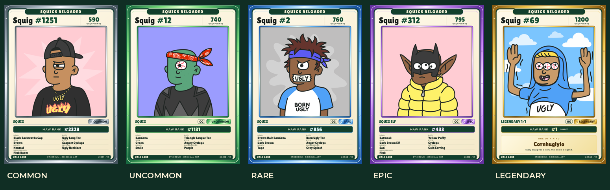

# Squigs Reloaded trading cards

Open a Squig's **Share Passport**, open its share controls, and choose
**Squigs Reloaded Trading Card**. The same format is available from **Share image**.
A direct public link is `/share?kind=passport&entity=312&format=trading-card`.

The existing `/api/share` endpoint returns a 1500 × 2100 PNG. Preview, download,
and native file sharing reuse those exact bytes. The filename identifies the
Squig. Everyone can generate public token cards; no ownership claim, wallet,
collector achievements, private history, or custom-art preference is included.

## Presentation

The complete original square artwork sits inside a rarity-coloured frame:
silver Common, green Uncommon, blue Rare, purple Epic, and gold Legendary.
An independent OG stamp follows the indexed flag. The front contains the token
ID, indexed UglyPoints and Maw Rank, Type, and all non-empty ordinary visual
traits. Blank/None traits are omitted; whitespace is normalized. Legendary cards
use their Legend name and a distinct lower panel. Their shared Maw Rank #1 is
explicitly labelled SHARED. No values are inferred from the image.

Examples: [Epic #312](evidence/trading-cards/epic-312.png),
[Legendary #69](evidence/trading-cards/legendary-69.png).

These are digital fronts, not printer-specific press files. No back, bleed,
QR code, issuance serial, or owner restriction is introduced. V1 is the design
version, not a numbered limited edition. The card preserves the metadata observed
at generation; regenerating it after a metadata correction produces updated data.

## Architecture and operational limits

- `format=trading-card` is valid only for numeric Squig/passport requests.
- `shareCard()` selects only public token metadata, avoiding progression and
  collector queries for this format.
- `trading-card.ts` creates the typed projection; `trading-card-render.tsx` uses
  the existing `ImageResponse` renderer with local licensed font files.
- Original artwork comes through the existing `squigImage()`/`artworkBatch()`
  pipeline. Missing or undecodable artwork fails the export with a retry action;
  the generic social-card placeholder fallback never applies to trading cards.
- The cache includes the complete projection (including source hash/update date),
  fixed layout and design version. Social shape/style settings do not fragment
  trading-card cache entries. Trading cards are cached for ten minutes; standard
  cards retain their one-minute TTL. All responses remain private/no-store and
  the endpoint still rechecks the projection before returning an image.
- The shared image cache is bounded to 24 entries and 48 MB total. Trading PNGs
  below 8 MB are eligible; standard cards keep their 2 MB per-image threshold.
  Identical in-flight work is coalesced. Existing concurrency and rate limits
  remain unchanged. No new database migration, external service or package.
- Social link metadata retains a landscape/square social export instead of
  advertising portrait dimensions to social platforms.

Fonts are bundled rather than fetched during export. Their OFL licences are in
`assets/fonts/`. Next output tracing explicitly includes the TTF assets.

## Validation

Unit tests cover all 4,444 canonical records, format validation, exact image
size, distinct frames, four-corner artwork preservation, Legendary values/names,
missing/corrupt artwork, public projection, filenames, state-change rejection,
and caching of larger images. The existing database/browser suite additionally
checks mobile format switching, portrait preview dimensions, download filename,
single-fetch preview/download reuse, and restoring social controls.

The reference examples use the original collection website PNGs. Local samples
are roughly 411–489 KB per card. Production peak render memory and real iOS native
sharing should still be observed after release.

### Source-data discrepancy

Squig #312's canonical committed metadata calls its Eyes trait `Cyclops` although
the original artwork visibly has three eyes. The card intentionally follows the
existing dataset. Correcting that source record, if desired, is separate from this
feature and must be reconciled with other ecosystem consumers.
